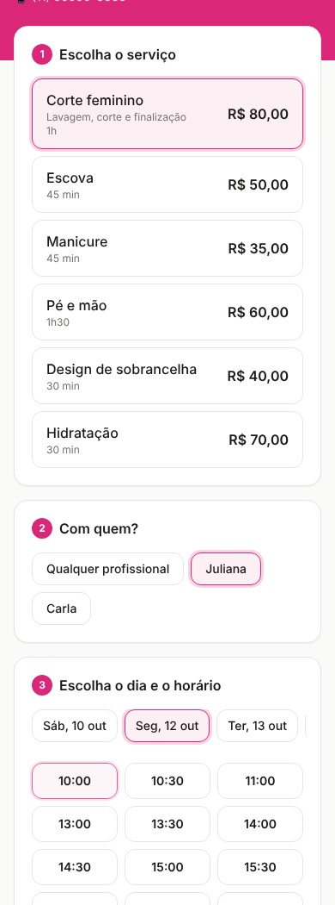
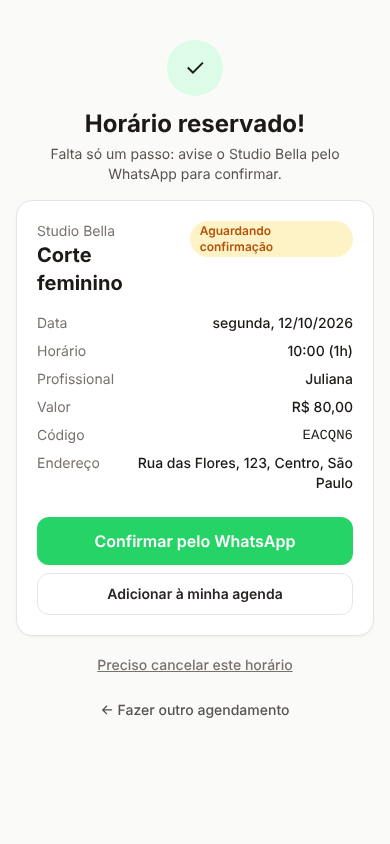
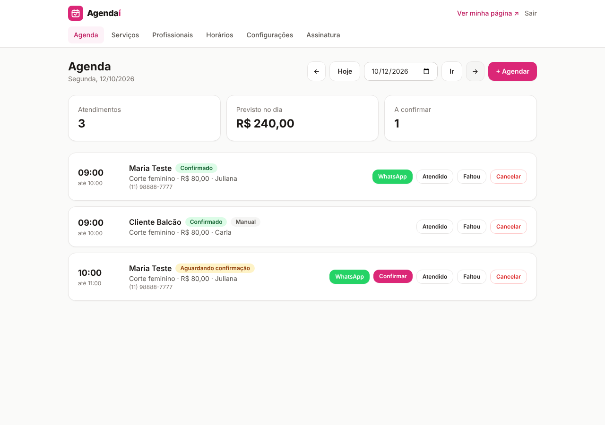

# Agendaí

Agendamento online para salões, barbearias, manicures e estúdios de beleza. O cliente abre o link do estabelecimento, escolhe serviço, profissional e horário, e confirma pelo WhatsApp. O dono acompanha tudo num painel feito para usar no celular, e paga uma assinatura mensal.

| Página de agendamento | Confirmação | Painel |
|---|---|---|
|  |  |  |

## O que o MVP já faz

**Para o cliente** (`/nome-do-salao`)
- Lista de serviços com duração e preço, na cor do estabelecimento.
- Escolha de profissional ou "qualquer profissional" (o sistema pega o primeiro livre).
- Horários livres calculados na hora: respeitam expediente, intervalo de almoço, duração do serviço, antecedência mínima e a agenda de cada profissional.
- Tela de confirmação com botão **Confirmar pelo WhatsApp** (mensagem pronta para o salão), botão para o Google Agenda e opção de cancelar.

**Para o dono** (`/painel`)
- Cadastro em 1 passo, já com horários e serviços de exemplo e 14 dias grátis.
- Agenda do dia com totais, confirmar, marcar atendido, faltou ou cancelar.
- Botão de WhatsApp em cada agendamento com lembrete pronto para o cliente.
- Agendamento manual (cliente do balcão ou que ligou), com aviso de conflito e opção de encaixe.
- Serviços, profissionais, horário de funcionamento, cor, endereço e regras de agendamento.
- Assinatura mensal pelo Mercado Pago (cartão recorrente). Quando o teste acaba sem pagamento, a página pública pausa e mostra um botão de WhatsApp.

## Stack

Next.js 14 (App Router, Server Actions) · TypeScript · Tailwind · Prisma + Postgres · sessão com JWT em cookie httpOnly · Mercado Pago Assinaturas (preapproval) · Vitest.

## Rodando localmente

```bash
cp .env.example .env          # preencha DATABASE_URL, DIRECT_URL e AUTH_SECRET
npm install
npx prisma migrate dev        # cria as tabelas
npm run db:seed               # cria o salão de exemplo /studio-bella (demo@agendai.app / demo1234)
npm run dev
```

Testes: `npm test`.

## Deploy na Vercel

1. Crie um banco Postgres grátis no [Neon](https://neon.tech) (ou Vercel Postgres / Supabase).
2. Importe o repositório na Vercel e configure as variáveis do `.env.example`:
   - `DATABASE_URL` (URL com pooler) e `DIRECT_URL` (URL direta, usada nas migrations)
   - `AUTH_SECRET` (`openssl rand -base64 32`)
   - `NEXT_PUBLIC_APP_URL` (ex: `https://agendai.vercel.app`)
3. Deploy. O script `vercel-build` aplica as migrations automaticamente.
4. Opcional: rode `npm run db:seed` apontando para o banco de produção para ter a página de exemplo usada na landing.

## Ativando o pagamento (Mercado Pago)

O checkout fica desligado até existir a chave; o resto do app funciona normalmente.

1. Em [Suas integrações](https://www.mercadopago.com.br/developers/panel/app) crie uma aplicação e copie o **Access Token** de produção para `MP_ACCESS_TOKEN`.
2. Em **Webhooks**, cadastre `https://SEU_DOMINIO/api/webhooks/mercadopago` com os eventos **Planos e assinaturas** e copie a assinatura secreta para `MP_WEBHOOK_SECRET`.
3. Ajuste `PLAN_PRICE` (padrão 39.90) e `TRIAL_DAYS` (padrão 14) se quiser.

Fluxo: o dono clica em "Assinar", é levado ao checkout do Mercado Pago, e o webhook (ou a volta do checkout) marca a assinatura como ativa. Cancelamento pelo painel mantém a agenda no ar até o fim do mês pago.

## Próximos passos sugeridos

- Lembrete automático por WhatsApp (API oficial ou Z-API) 24h antes.
- Bloqueio de dias/horários específicos (férias, feriado).
- Serviços por profissional e comissão.
- Pix recorrente (Asaas) como alternativa ao cartão.
- Relatório mensal de faturamento e clientes que mais voltam.
